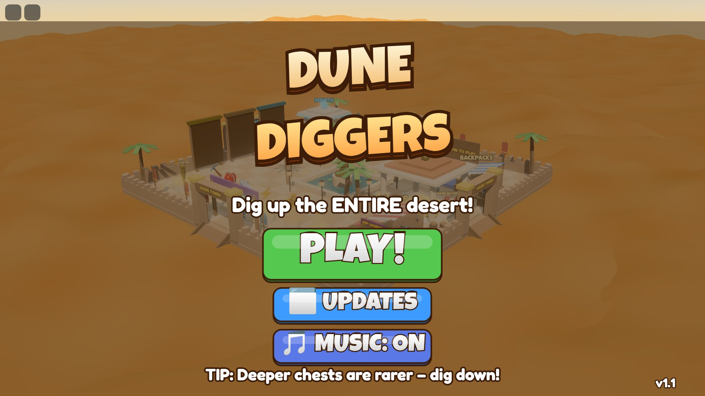
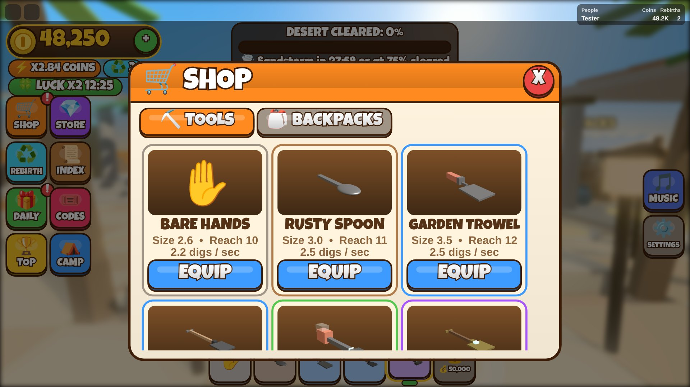
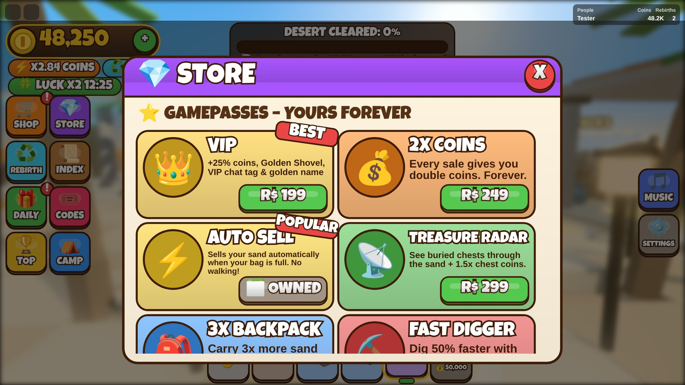
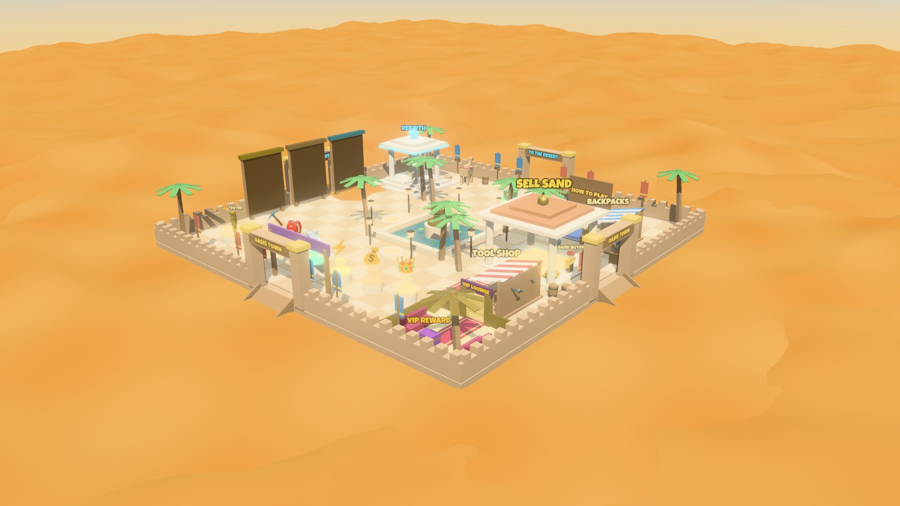

# 🏜️ Dune Diggers – Roblox hra

Vykopej celou poušť – začínáš s holýma rukama, končíš s obřím bagrem.
Prodávej písek, kupuj lepší nástroje, hledej zakopané truhly, artefakty
a ztracené ruiny. Když hráči vykopou většinu pouště, přijde **písečná bouře**
a všechno znovu zasype – s novými poklady.

> Hra je **originální** (vlastní název, vzhled a herní prvky). Je inspirovaná
> žánrem „kopej a vylepšuj" z videa, ale nekopíruje cizí hru – to je důležité,
> aby ti ji Roblox nesmazal a abys ji mohl/a v klidu propagovat.

## 🆕 Verze 1.1 – co je nového

| | |
|---|---|
|  |  |
|  |  |
|  |  |

- 🏝️ **Nová velká lobby „Oasis Town"** (120×120): oáza s vodou a zlatou sochou, trh s obchodníky,
  prodejní pavilon, rebirth chrám, brány s rampami, VIP salonek, denní truhla, tabule „How to play"
- 🏆 **Globální žebříčky** (mince, písek, rebirthy) na tabulích v lobby i v UI + **socha hráče č. 1**
- 🎵 **Originální hudba a zvuky** – 3 hudební smyčky (lobby, poušť, bouře), vítr a 12 efektů
- ✨ **Úplně nové UI**: hlavní menu s průletem kamery, 3D tlačítka, animované mince,
  obchod s **otáčejícími se 3D náhledy nástrojů**, okna se rozmazaným pozadím, nastavení (hlasitost, low graphics)
- 🎁 **Denní odměny** a **VIP truhla**
- 🎒 **Vlastní výběr nástrojů** místo Roblox hotbaru: 3D náhledy, klávesy 1–9, LB/RB na ovladači,
  zamčený slot s cenou dalšího nástroje
- 🧱 **Opraveno „vidění skrz písek"** (po kopání se mažou tenké průsvitné zbytky terénu, kamera nesmí do zdí)
- 📸 Náhledy výše jsou vyrenderované přímo z kódu hry (viz `tests/preview_export.luau`) – ve hře to vypadá velmi podobně.

## Co hra obsahuje

| Funkce | Popis |
|---|---|
| ⛏️ Kopání do terénu | Skutečně deformovatelná poušť (Roblox Terrain), přesný výpočet vykopaného písku |
| 🛠️ 8 nástrojů | Holé ruce → lžíce → lopatka → lopata → vysavač → **Zlatá lopata (VIP)** → foukač → Titan bagr |
| 🎒 8 batohů | Od kapsy (30) po silo (600 000 písku) |
| 💰 Ekonomika | Prodej na zlaté ploše v táboře, rebirth (+50 % mincí navždy) |
| 🎁 Poklady | Truhly 5 rarit zakopané v různých hloubkách – hlouběji = vzácnější |
| 📜 Artefakty | 10 sběratelských artefaktů, každý dává trvalý bonus k mincím |
| 🏛️ Ztracené ruiny | Zasypaný chrám s mýtickou relikvií (oznámení celému serveru) |
| 🌪️ Písečná bouře | Server-wide event, znovu zasype poušť a přesune ruiny |
| 💎 6 gamepassů + 4 produkty | VIP, 2x Coins, Auto Sell, Treasure Radar, 3x Backpack, Fast Digger, balíčky mincí, Server Luck |
| 🎟️ Kódy | Pro TikTok/Instagram (`TIKTOK`, `INSTA`, …) |
| 👥 Skupina | Bonus +10 % pro členy tvé Roblox skupiny |
| 💾 Ukládání | DataStore se zámkem proti ztrátě dat, ochrana nákupů proti dvojímu připsání |
| 🏝️ Lobby Oasis Town | Velké město s obchody, NPC, oázou, VIP salonkem a žebříčky |
| 🏆 Žebříčky | Globální (OrderedDataStore) + socha nejlepšího hráče |
| 🎵 Hudba | Originální, mění se podle místa (lobby / poušť / bouře) |
| 🎁 Denní odměny | Denní truhla pro všechny, VIP truhla pro VIP |
| 📱 Mobil/PC/konzole | UI se samo škáluje, kopání dotykem, myší i ovladačem |

## Rychlý start (5 minut)

1. Stáhni si **Roblox Studio**: <https://create.roblox.com>
2. Stáhni z tohoto repozitáře soubor **`DuneDiggers.rbxlx`**.
3. Otevři ho v Roblox Studiu (dvojklik nebo *File → Open from File*).
4. Zmáčkni **Play** (F5) a kopej 🎉

Celý podrobný návod (publikování, gamepassy, ukládání, nastavení hry):
👉 **[docs/NAVOD.md](docs/NAVOD.md)**

## Dokumentace

- 📘 [docs/NAVOD.md](docs/NAVOD.md) – krok za krokem od nuly po zveřejněnou hru
- 💎 [docs/GAMEPASSY.md](docs/GAMEPASSY.md) – gamepassy a produkty: texty, ceny, ikony, jak je vytvořit
- 📱 [docs/MARKETING.md](docs/MARKETING.md) – TikTok & Instagram: scénáře videí, plán na 30 dní, hashtagy
- 🎨 [marketing/README.md](marketing/README.md) – hotové grafiky: ikona, příspěvky na IG, story, thumbnail

## Struktura projektu

```
src/
  shared/              -> ReplicatedStorage/Shared
    Config.luau          ⭐ VŠECHNO NASTAVENÍ HRY (ceny, nástroje, gamepass ID, kódy, hudba)
    Remotes.luau         komunikace server <-> klient
    Util.luau            formátování čísel a času
    ToolFactory.luau     modely nástrojů (do ruky, do lobby i do náhledů v obchodě)
  server/              -> ServerScriptService/Server
    Main.server.luau     spouští hru
    Services/
      WorldService       generování pouště a ruin + kopání do terénu
      LobbyBuilder       lobby Oasis Town (stavby, NPC, oáza, VIP salonek…)
      Build              pomocné funkce pro stavění z partů
      LeaderboardService globální žebříčky + socha hráče č. 1
      RewardService      denní odměny, VIP salonek, gamepass stánky
      DigService         ověření a zpracování kopání (proti hackům)
      TreasureService    truhly, artefakty, relikvie
      ShopService        prodej, obchod, rebirth, kódy, teleport
      MonetizationService gamepassy a developer produkty
      SandstormService   písečná bouře
      DataService        ukládání dat
      Stats              výpočty bonusů
  client/              -> StarterPlayer/StarterPlayerScripts/Client
    Main.client.luau     hlavní menu -> hra, propojení všeho
    UI.luau              vstup do UI (HUD + okna + menu)
    UIKit.luau           stavebnice UI (3D tlačítka, panely, posuvníky…)
    Hud.luau             mince, menu, banner pouště, batoh, notifikace
    Hotbar.luau          vlastní výběr nástrojů (místo Roblox hotbaru)
    Windows.luau         okna: Shop, Store, Rebirth, Index, Codes, Top, Settings
    MainMenu.luau        úvodní obrazovka s průletem kamery
    Audio.luau           hudba, ambience, zvukové efekty
    DigController.luau   ovládání kopání
    Effects.luau         prach, čísla, bouře, třesení kamery
assets/audio/          originální hudba a zvuky (nahraj na Roblox, viz návod 6.5)
tools/build_place.py   sestaví DuneDiggers.rbxlx ze src/
tools/audio/           generátor hudby a zvuků (Python)
tools/graphics/        generátor marketingových grafik (three.js)
marketing/graphics/    hotové grafiky pro Instagram/TikTok/Roblox
tests/                 automatické testy logiky mimo Roblox
default.project.json   pro Rojo (pokročilí)
```

## Pro pokročilé

- **Rojo**: `rojo serve` + Rojo plugin ve Studiu – kód pak upravuješ ve VS Code.
- **Nový place soubor** po úpravě kódu: `python3 tools/build_place.py`
- **Testy**: viz [tests/README.md](tests/README.md)
- **Lint**: `selene src` (konfigurace `selene.toml` + `roblox_lite.yml`), formát: `stylua src`
