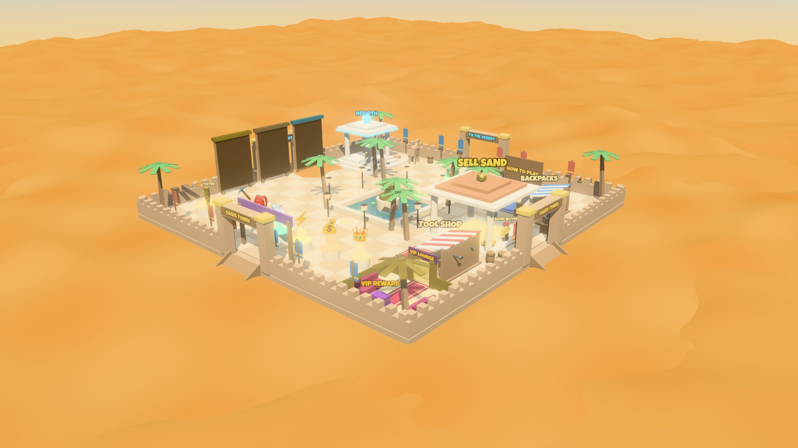

# 📘 Návod: od nuly po zveřejněnou hru

Tenhle návod tě provede vším: spuštěním hry, publikováním na Roblox,
zapnutím ukládání, vytvořením gamepassů, nastavením stránky hry a úpravami.

> 💡 Roblox občas mění vzhled Studia a webu. Když se tlačítko jmenuje trochu
> jinak, hledej podobný název – postup zůstává stejný.

---

## Obsah

1. [Co budeš potřebovat](#1-co-budeš-potřebovat)
2. [Otevření hry v Roblox Studiu](#2-otevření-hry-v-roblox-studiu)
3. [První test (Play)](#3-první-test-play)
4. [Publikování na Roblox](#4-publikování-na-roblox)
5. [Zapnutí ukládání dat](#5-zapnutí-ukládání-dat)
6. [Gamepassy a developer produkty](#6-gamepassy-a-developer-produkty)
   - [6.5 Hudba a zvuky](#65-hudba-a-zvuky)
7. [Nastavení stránky hry (ikona, obrázky, popis)](#7-nastavení-stránky-hry)
8. [Zveřejnění hry pro všechny](#8-zveřejnění-hry-pro-všechny)
9. [Roblox skupina a kódy](#9-roblox-skupina-a-kódy)
10. [Úpravy hry (Config)](#10-úpravy-hry-config)
11. [Aktualizace běžící hry](#11-aktualizace-běžící-hry)
12. [Řešení problémů](#12-řešení-problémů)
13. [Pro pokročilé: Rojo + VS Code](#13-pro-pokročilé-rojo--vs-code)
14. [Kontrolní seznam před spuštěním](#14-kontrolní-seznam-před-spuštěním)

---

## 1. Co budeš potřebovat

- **Roblox účet** (ideálně s ověřeným e-mailem; pro prodej gamepassů a výběr peněz může Roblox chtít ověření věku/identity).
- **Počítač** s Windows nebo macOS (Roblox Studio na mobilu nejde).
- **Roblox Studio** – stáhneš zdarma na <https://create.roblox.com> → *Start Creating*.
- Soubor **`DuneDiggers.rbxlx`** z tohoto repozitáře
  (na GitHubu klikni na soubor → tlačítko *Download raw file*, nebo celý projekt přes *Code → Download ZIP*).

> 👶 Pokud ti je méně než 18 let: s prodejem za Robux a hlavně s výběrem
> peněz (DevEx) ti musí pomoct rodič. DevEx je od 13 let a vyžaduje ověření.

---

## 2. Otevření hry v Roblox Studiu

1. Spusť **Roblox Studio** a přihlas se.
2. *File → Open from File…* (nebo dvojklik na `DuneDiggers.rbxlx`).
3. V okně **Explorer** (když ho nevidíš: *View → Explorer*) uvidíš:

```
Workspace                      (prázdný – poušť se vygeneruje při spuštění)
ReplicatedStorage
  └ Shared
      ├ Config     ⭐ tady se nastavuje všechno
      ├ Remotes
      └ Util
ServerScriptService
  └ Server
      ├ Main       (hlavní skript serveru)
      └ Services   (logika hry)
StarterPlayer
  └ StarterPlayerScripts
      └ Client     (UI, ovládání, efekty)
```

Nic nemusíš stavět ručně – **celá mapa (poušť, tábor, ruiny, truhly) se
vytvoří kódem při spuštění hry**. Proto je Workspace prázdný.

---

## 3. První test (Play)

1. Otevři okno **Output** (*View → Output*) – sem hra píše zprávy a chyby.
2. Zmáčkni **Play** (F5).
3. V Outputu uvidíš:
   ```
   [Dune Diggers] Generuji poušť...
   [Dune Diggers] Svět hotový za 2.3 s
   ```
   a pravděpodobně žluté varování, že se data **neukládají** a gamepassy nemají ID – to je zatím v pořádku (vyřešíme v krocích 5 a 6).
4. Objeví se **hlavní menu** (kamera krouží nad městem). Klikni **PLAY!**
   (dokud se poušť generuje, tlačítko ukazuje *LOADING...*).
5. **Jak se hraje:**
   - Začínáš v lobby **Oasis Town** (město s oázou uprostřed pouště). Vyjdi kteroukoliv **branou** ven.
   - Drž **levé tlačítko myši** (na mobilu prst) → kopeš tam, kam míříš. V lobby se kopat nedá.
   - Písek se ukládá do batohu (lišta dole). Když je plný, vrať se na **zlatou plochu „SELL SAND"** v pavilonu.
   - Nástroje a batohy kupuješ v **🛒 SHOP** (tlačítko vlevo, nebo u stánků **TOOL SHOP** / **BACKPACKS**).
   - Když odkopeš písek nad truhlou, rozsvítí se → přijdi k ní a otevři ji (**E** / tap).
   - **⛺ CAMP** tě teleportuje zpět do lobby, **🎁 DAILY** dá denní odměnu, **🏆 TOP** ukáže žebříček.
   - **⚙️ SETTINGS**: hlasitost hudby a zvuků, *Low graphics* pro slabší mobily.
6. Zastav test: **Stop** (Shift+F5).

### Co je v lobby (Oasis Town)



| Místo | K čemu je |
|---|---|
| 🏝️ Oáza se zlatou sochou | Střed města, kolem jsou 4 spawny |
| 💰 SELL STATION (pavilon na západě) | Prodej písku – stoupni na zlatou plochu |
| 🛒 TOOL SHOP / 🎒 BACKPACKS | Stánky s obchodníky (otevřou obchod) |
| ♻️ REBIRTH chrám (severovýchod) | Rebirth |
| 🏆 3 tabule + socha (východ) | Globální žebříčky, socha nejbohatšího hráče |
| ⭐ GAMEPASSES (jih) | Zářící koule – přijdi a kup gamepass |
| 👑 VIP LOUNGE (jihozápad) | Jen pro VIP: VIP truhla s odměnou |
| 🎁 DAILY REWARD (sever) | Denní truhla |
| 🚪 4 brány | Ven do pouště (rampy dolů se odkryjí, až hráči vykopou písek kolem) |

> 🧪 Tip na testování: v `Config` nastav `Testing.StudioStartCoins = 1000000`
> a ve Studiu budeš mít hned milion mincí. `Testing.GiveAllPassesInStudio = true`
> ti ve Studiu zapne všechny gamepassy. (Ve skutečné hře se to neprojeví.)

**Test s více hráči:** *Test → Clients and Servers →* vyber 2 hráče → *Start*.
Uvidíš, jak se kopání a bouře synchronizují mezi hráči.

---

## 4. Publikování na Roblox

1. *File → Publish to Roblox* (zkratka **Alt+P**).
2. Vyber **Create new experience**.
3. Vyplň:
   - **Name:** `Dune Diggers` (nebo vlastní název – pak ho změň i v `Config.GameName`)
   - **Description:** viz [docs/MARKETING.md](MARKETING.md#popis-hry-na-roblox) – je tam hotový text
   - **Genre:** *Simulation* (nebo *Adventure*)
   - **Devices:** zaškrtni **Computer, Phone, Tablet** (a klidně Console)
4. Klikni **Create**.

Hra je teď na Robloxu, ale zatím **soukromá** (vidíš ji jen ty).

> ⚠️ Po každé změně ve Studiu musíš znovu dát **Publish** (Alt+P),
> jinak se změna do opravdové hry nedostane.

---

## 5. Zapnutí ukládání dat

Aby se hráčům ukládaly mince a nástroje i při testování ve Studiu:

1. Ve Studiu otevři **Game Settings** (na liště *Home* nebo *File → Game Settings*).
2. Sekce **Security**.
3. Zapni **Enable Studio Access to API Services**.
4. **Save**.

Ve zveřejněné hře se ukládá automaticky (není potřeba nic zapínat).

Jak ukládání funguje:
- automaticky každou minutu, při odchodu hráče a při vypnutí serveru,
- s „zámkem“, aby se data nepřepsala, když hráč rychle přejde na jiný server,
- nákupy za Robux se uloží okamžitě.

---

## 6. Gamepassy a developer produkty

**Gamepass** = koupí se jednou, platí navždy (VIP, 2x Coins…).
**Developer produkt** = dá se koupit opakovaně (balíček mincí, Server Luck).

Kompletní seznam s texty, cenami a nápady na ikony:
👉 **[docs/GAMEPASSY.md](GAMEPASSY.md)**

### 6.1 Vytvoření gamepassu

1. Jdi na <https://create.roblox.com/dashboard/creations>.
2. Klikni na svou hru **Dune Diggers**.
3. V levém menu: **Monetization → Passes**.
4. **Create a Pass**:
   - nahraj ikonu (čtverec, ideálně **512×512 px**, PNG/JPG),
   - **Name** a **Description** (zkopíruj z GAMEPASSY.md),
   - klikni **Create Pass**.
5. Klikni na vytvořený pass → v levém menu **Sales** → zapni **Item for Sale** → zadej **cenu** → **Save Changes**.
6. Zkopíruj **ID passu**: v seznamu passů klikni na **⋯ → Copy Asset ID**
   (nebo je to číslo v adrese stránky passu).

Opakuj pro všech 6 gamepassů: **VIP, 2x Coins, Auto Sell, Treasure Radar, 3x Backpack, Fast Digger**.

### 6.2 Vytvoření developer produktu

1. Stejná stránka hry → **Monetization → Developer Products**.
2. **Create a Developer Product** → ikona, název, popis, **cena** → **Create**.
3. Zkopíruj **Product ID** (⋯ → Copy ID / číslo v seznamu).

Vytvoř 4 produkty: **Server Luck, Coin Pouch, Coin Chest, Coin Vault**.

### 6.3 Vložení ID do hry

1. Ve Studiu: *ReplicatedStorage → Shared → Config* (dvojklik).
2. Najdi sekci `Config.GamePasses` a u každého passu nahraď `Id = 0` svým číslem:

```lua
VIP = {
    Id = 1234567890,   -- ← sem tvoje ID
    Name = "VIP",
    ...
```

3. Stejně tak v `Config.Products` pro produkty.
4. **Publish** (Alt+P).

### 6.4 Test nákupů

- Ve Studiu se nákupy dělají „naoko“ – **neplatíš žádné Robux**. Zmáčkni Play → **💎 STORE** → klikni na cenu → potvrď testovací nákup.
- Funkce gamepassu se aktivuje hned (bez nutnosti se odpojit).
- Pozor: ve Studiu Roblox **nepamatuje** koupené gamepassy mezi testy. Na trvalé testování použij `Testing.GiveAllPassesInStudio = true`.
- V Output nesmí být varování `Gamepassy bez ID` – pokud ano, nějaké ID chybí.

### 6.5 Hudba a zvuky

Hra má **vlastní originální hudbu a zvuky** (složené kódem, žádná autorská práva) ve složce
**`assets/audio/`**. Roblox ale neumí přehrát zvuk přímo z place souboru – musíš je jednou nahrát:

| Soubor | Kam vložit ID v `Config` | Kdy hraje |
|---|---|---|
| `music_oasis.ogg` | `Config.Music.Lobby` | hlavní menu a lobby |
| `music_desert.ogg` | `Config.Music.Desert` | kopání v poušti |
| `music_storm.ogg` | `Config.Music.Storm` | písečná bouře |
| `ambience_wind.ogg` | `Config.Music.Ambience` | vítr venku v poušti |
| `sfx_pack.ogg` | `Config.SfxPack` | všechny zvukové efekty (kopání, mince, truhly…) v jednom souboru |

1. Jdi na <https://create.roblox.com> → **Creations → Development Items → Audio**
   (případně ve Studiu *View → Asset Manager → Import*).
2. Nahraj všech 5 souborů (každý zvlášť, název třeba „Dune Diggers – Desert Music“).
3. U každého zkopíruj **ID** (⋯ → *Copy Asset ID*).
4. V `Config` je vlož ve tvaru `"rbxassetid://ČÍSLO"`:
   ```lua
   Config.Music = {
       Lobby = "rbxassetid://1234567890",
       Desert = "rbxassetid://1234567891",
       Storm = "rbxassetid://1234567892",
       Ambience = "rbxassetid://1234567893",
       Volume = 0.5,
   }
   Config.SfxPack = "rbxassetid://1234567894"
   ```
5. **Publish** a vyzkoušej (Play). Dokud ID chybí, hra jede bez hudby a použije záložní vestavěné zvuky.

> ⚠️ Nahrávání zvuků má měsíční limit (podle ověření účtu) – 5 souborů se vejde.
> Pokud hra patří **skupině**, nahraj zvuky pod skupinou (jinak je hra nesmí použít).
>
> Chceš jinou hudbu? Uprav `tools/audio/compose.py` (tempo, melodie) a spusť
> `python3 tools/audio/compose.py` – vytvoří nové soubory.

---

## 7. Nastavení stránky hry

Na <https://create.roblox.com/dashboard/creations> → tvoje hra:

| Kde | Co nastavit |
|---|---|
| **Configure → Basic Settings** (nebo *Overview*) | Název, popis, žánr |
| **Places → Configure / Thumbnails** | **Ikona** 512×512 a **thumbnaily** 1920×1080 (nahraj aspoň 3) |
| **Access / Settings** | Zařízení (PC, telefon, tablet, konzole) |
| **Places → Configure Place → Access** | **Max players** – doporučuju **12** (víc hráčů = poušť zmizí rychleji = víc bouří) |
| **Avatar** | R15 (výchozí) |
| **Questionnaire** | Vyplň dotazník **Maturity & Compliance** (hra je vhodná pro všechny věkové kategorie – žádné násilí, žádný chat navíc) |

Nápady na ikonu a thumbnaily (+ hotové AI prompty): [docs/MARKETING.md](MARKETING.md#ikona-a-thumbnaily).

> 💡 Ikona je to nejdůležitější, co ovlivňuje, jestli hráč na hru klikne.
> Výrazné barvy, jedna hlavní věc (postavička s lopatou + truhla), velký
> čitelný text max. 2 slova.

---

## 8. Zveřejnění hry pro všechny

1. Creator Hub → tvoje hra → najdi **Privacy / Access** (nebo ve Studiu *Game Settings → Permissions*).
2. Přepni z **Private** na **Public**.
3. Roblox může před zveřejněním chtít vyplnit dotazník (krok 7) a ověřit účet – průvodce tě navede.
4. Hotovo – zkopíruj si odkaz na hru (např. `https://www.roblox.com/games/123456789/Dune-Diggers`) a dej ho do TikTok/Instagram bia.

---

## 9. Roblox skupina a kódy

### Skupina (doporučuju!)
Skupina je skvělá pro komunitu (oznámení, fanoušci) a hra dává členům **+10 % mincí**.

1. Na roblox.com → **Communities / Groups → Create** (založení stojí Robux).
2. Z adresy skupiny zkopíruj ID (`roblox.com/communities/`**`12345678`**`/...`).
3. V `Config` nastav:
   ```lua
   Config.Group = {
       Id = 12345678,
       CoinBonus = 0.1,
   }
   ```
4. Publish.

### Kódy
V `Config.Codes` přidáváš kódy, které pak zveřejňuješ ve videích:

```lua
Config.Codes = {
    RELEASE = { Coins = 250 },
    TIKTOK = { Coins = 500 },
    INSTA = { Coins = 500 },
    DIGDEEP = { Coins = 1000 },
    ["1KLIKES"] = { Coins = 2000 },   -- nový kód = nový důvod sledovat tvůj TikTok
}
```

- Na velikosti písmen nezáleží (`tiktok` = `TIKTOK`).
- Každý hráč může kód použít jen jednou.
- Odměna se násobí počtem rebirthů + 1, takže kód potěší i pokročilé hráče.
- Starý kód zrušíš tak, že ho z `Config.Codes` smažeš.

---

## 10. Úpravy hry (Config)

Všechno důležité je v **`ReplicatedStorage/Shared/Config`**. Pár příkladů:

| Chci… | Uprav |
|---|---|
| Větší / menší poušť | `Config.World.Size` (musí být dělitelné 64; 512 je dobrý střed, 768 = větší, ale náročnější) |
| Vyšší duny | `Config.World.DuneHeight` |
| Víc mincí za písek | `Config.Economy.CoinsPerSand` |
| Levnější nástroj | `Price` v `Config.Tools` |
| Nový nástroj | přidej řádek do `Config.Tools` (např. `{ Id = "Drill", Icon = "🔩", Name = "Power Drill", Price = 20000, Radius = 5.5, Cooldown = 0.2, Reach = 20, Swing = false }`) |
| Častější bouře | `Config.Sandstorm.Interval` (sekundy) a `ClearedThreshold` |
| Víc truhel | `Config.Treasure.StartChests` a `MaxChests` |
| Jiné zvuky | `Config.Sounds` – vlož `rbxassetid://ČÍSLO` zvuku z Creator Store (*View → Toolbox → Audio*) |

### Vlastní modely nástrojů
Nástroje se staví kódem z kostiček. Chceš hezčí model?

1. Postav ho ve Studiu (nebo vezmi z Toolboxu) jako objekt typu **Tool** s částí **Handle**.
2. Do **ServerStorage** vlož složku **`CustomTools`**.
3. Tool do ní dej a **pojmenuj ho přesně podle `Id`** z Configu (např. `Spoon`, `Shovel`, `Excavator`).
4. Hra pak místo kostičkového modelu použije tvůj.

> Tip: natočení v ruce se nastavuje vlastností `Grip` u Toolu (nebo pluginem „Tool Grip Editor").

---

## 11. Aktualizace běžící hry

1. Udělej změnu ve Studiu, otestuj (Play).
2. **Publish** (Alt+P).
3. Hráči na starých serverech mají starou verzi. Aby dostali novou:
   Creator Hub → hra → **⋯ → Restart servers / Shut Down All Servers**
   (lepší je *Migrate to Latest Update* – hráče přesune bez vyhození, pokud je ta možnost k dispozici).
4. Napiš o updatu na TikTok/Instagram 😉 – „UPDATE" videa fungují skvěle.

---

## 12. Řešení problémů

| Problém | Řešení |
|---|---|
| **Data se neukládají ve Studiu** | Krok 5 – zapni *Studio Access to API Services* (hra musí být publikovaná). |
| **„This gamepass is not set up yet"** | Chybí ID v `Config.GamePasses` (krok 6.3), nebo pass není *For Sale*. |
| **Nákup proběhl, ale nic se nestalo** | Zkontroluj, že ID v Configu přesně sedí. V Output hledej `[Monetization]`. |
| **Hráč se nespawnuje** | Podívej se do Output na červenou chybu. Hra spawnuje postavy až po vygenerování pouště (pár sekund). |
| **Hra laguje** | Zmenši `Config.World.Size` (např. 384) nebo `Config.Treasure.MaxChests`. Sniž `Max players`. |
| **Nekope to** | Musíš držet nástroj v ruce (klávesa **1**) a mířit na písek do vzdálenosti dosahu nástroje. |
| **Batoh je plný** | Prodej na zlaté ploše v táboře (⛺ CAMP tě tam teleportuje), nebo kup Auto Sell. |
| **Chci začít data od nuly** | Změň `STORE_NAME` v `DataService` (např. `_v2`) – všichni začnou znovu. ⚠️ Ve zveřejněné hře to nedělej! |
| **Chyba po úpravě Configu** | Nejspíš chybí čárka nebo uvozovka. Output ukáže číslo řádku. |
| **Nehraje hudba** | Chybí ID v `Config.Music` (krok 6.5), nebo zvuk nahrál jiný účet než vlastník hry. V Settings zkontroluj hlasitost. |
| **Žebříčky jsou prázdné** | Globální žebříčky fungují ve zveřejněné hře (s DataStore). Ve Studiu ukazují jen hráče na serveru; tabule se obnovují každých 90 s. |
| **Jde vidět skrz písek** | Opraveno ve v1.1 (po kopání se mažou tenké zbytky písku, kamera nesmí do zdí). Pokud to pořád vidíš, pošli screenshot. |
| **Slabý mobil laguje** | Hráč si zapne *Low graphics* v ⚙️ Settings (vypne prach a třesení kamery). |

---

## 13. Pro pokročilé: Rojo + VS Code

Pokud chceš psát kód ve VS Code a mít ho v Gitu:

1. Nainstaluj **Rojo** (<https://rojo.space>) – CLI + plugin do Studia (nebo VS Code rozšíření „Rojo").
2. Ve složce projektu: `rojo serve`
3. Ve Studiu otevři Rojo plugin → **Connect**.
4. Teď se změny v `src/` okamžitě propisují do Studia.

Nový `.rbxlx` bez Roja: `python3 tools/build_place.py`.
Automatické testy logiky: [tests/README.md](../tests/README.md).

---

## 14. Kontrolní seznam před spuštěním

- [ ] Hra jde spustit (Play) bez červených chyb v Output
- [ ] Publikováno (Alt+P)
- [ ] Zapnuté *Studio Access to API Services* a otestované ukládání (odejdi a vrať se – mince zůstanou)
- [ ] 6 gamepassů vytvořeno, **For Sale**, ID v Configu
- [ ] 4 developer produkty vytvořeny, ID v Configu
- [ ] 5 zvukových souborů nahráno, ID v `Config.Music` a `Config.SfxPack`
- [ ] V Output **není** varování `Gamepassy bez ID`
- [ ] `Testing.GiveAllPassesInStudio = false` a `Testing.StudioStartCoins = 0`
- [ ] Ikona 512×512 + aspoň 3 thumbnaily 1920×1080
- [ ] Popis hry + žánr + zařízení (PC, telefon, tablet)
- [ ] Max players ~12
- [ ] Dotazník Maturity & Compliance vyplněn
- [ ] Hra přepnutá na **Public**
- [ ] Odkaz na hru v biu TikToku/Instagramu
- [ ] Připravená první 3 videa (viz [MARKETING.md](MARKETING.md))

Hodně štěstí – a ať je ta poušť pořádně vykopaná! 🏜️⛏️
